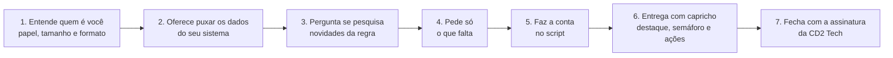

<div align="center">

<picture>
  <source media="(prefers-color-scheme: dark)" srcset="docs/assets/cd2tech-horizontal-white.svg">
  
</picture>

# Super para o varejo

**Skills de IA para o varejo alimentar, de graça para testar.**

[](#licença-em-português-simples)
[](#claude-code)
[](#claude-cowork)
[](#codex)
[](#chatgpt-work)
[](#deepseek-harness)
[](#gpt-store)
[](https://github.com/cd2tec/super/releases/latest)
[](https://cd2tec.github.io/super/)

**[Conheça o site das skills](https://cd2tec.github.io/super/)**

</div>

---

A CD2 Tech publica calculadoras gratuitas para o varejo alimentar. Este repositório leva a mesma conta para dentro do assistente de IA que você já usa: o plugin **`cd2-super`** tem uma skill para cada calculadora, e mais oito relatórios gerenciais, um painel de varejo e a ficha de ferramenta do Archeo MCP Creator da CD2. A skill entende quem é você, faz a conta com os números da sua loja e entrega o que fazer primeiro, com a marca CD2 Tech.

Os relatórios e o painel funcionam **com o banco do seu ERP conectado ou sem conexão nenhuma**, a partir de um arquivo que você exporta do sistema. Veja [Relatórios e painel](#relatórios-e-painel).

Funciona no [Claude Code](#claude-code), no [Claude Cowork](#claude-cowork), no [Codex](#codex), no [ChatGPT Work](#chatgpt-work) e no [DeepSeek Harness](#deepseek-harness). A [GPT Store](#gpt-store) chega em breve.

## O problema

A regra muda e a conta da loja continua sendo sua.

- **A escala 6x1 acaba em 16/12/2026.** A jornada cai de 44h para 40h sem acordo coletivo, ou até 42h com acordo, sempre com 2 folgas. Quantas pessoas você precisa contratar? Quanto isso pesa na folha? Qual setor aperta primeiro?
- **O vale tem teto de taxa.** Pelo Decreto 12.712/2025, a operadora pode cobrar no máximo 3,6% da sua loja e tem de repassar o dinheiro em até 15 dias. Muita loja ainda paga mais e espera mais, sem ver quanto isso soma no ano.

Quem toca supermercado, padaria ou mercado de bairro não tem tempo para juridiquês. A skill pergunta o que importa, faz a conta num script, nunca de cabeça, e diz de quando é cada regra que usou.

## As skills

<!-- skills:start -->
| Skill | O que faz | Regra | Site | Status |
| --- | --- | --- | --- | --- |
| **Fim da escala 6x1** (`fim-escala-6x1`) | Calcula o impacto do fim da escala 6x1 na folha e na operação da sua loja. | Emenda Constitucional 141/2026 | [calc-fim-escala6x1.cd2.com.br](https://calc-fim-escala6x1.cd2.com.br/?utm_source=github&utm_medium=skill&utm_campaign=fim-escala-6x1) | disponível |
| **Quanto o VR/VA custa de verdade** (`custo-vrva`) | Mostra o custo real do vale-refeição e do vale-alimentação para a sua empresa. | Decreto 12.712/2025 | [calc-vrva.cd2.com.br](https://calc-vrva.cd2.com.br/?utm_source=github&utm_medium=skill&utm_campaign=custo-vrva) | disponível |
| **Relatório de vendas** (`relatorio-vendas`) | Gera relatórios gerenciais de vendas, como a curva ABC, com a conta conferida. | Não se aplica | [archeo.cd2.com.br](https://archeo.cd2.com.br/?utm_source=github&utm_medium=skill&utm_campaign=relatorio-vendas) | disponível |
| **Relatório de estoque** (`relatorio-estoque`) | Gera relatórios gerenciais de estoque, como posição, Kardex e cobertura, com a conta conferida. | Não se aplica | [archeo.cd2.com.br](https://archeo.cd2.com.br/?utm_source=github&utm_medium=skill&utm_campaign=relatorio-estoque) | disponível |
| **Relatório de compras** (`relatorio-compras`) | Gera relatórios gerenciais de compras, como a curva ABC de abastecimento e os pedidos pendentes, com a conta conferida. | Não se aplica | [archeo.cd2.com.br](https://archeo.cd2.com.br/?utm_source=github&utm_medium=skill&utm_campaign=relatorio-compras) | disponível |
| **Relatório de preços** (`relatorio-precos`) | Gera relatórios gerenciais de preço, margem e promoção, com a conta conferida. | Não se aplica | [archeo.cd2.com.br](https://archeo.cd2.com.br/?utm_source=github&utm_medium=skill&utm_campaign=relatorio-precos) | disponível |
| **Relatório de perdas** (`relatorio-perdas`) | Gera relatórios gerenciais de perdas, como a quebra por motivo e o índice de perda, com a conta conferida. | Não se aplica | [archeo.cd2.com.br](https://archeo.cd2.com.br/?utm_source=github&utm_medium=skill&utm_campaign=relatorio-perdas) | disponível |
| **Relatório financeiro** (`relatorio-financeiro`) | Gera relatórios gerenciais financeiros, como o aging de contas a pagar e a receber e o fluxo de caixa. | Não se aplica | [archeo.cd2.com.br](https://archeo.cd2.com.br/?utm_source=github&utm_medium=skill&utm_campaign=relatorio-financeiro) | disponível |
| **Relatório fiscal** (`relatorio-fiscal`) | Confere documentos fiscais por CFOP, cabeçalho contra itens e numeração, como relatório gerencial e não documento oficial. | Não se aplica | [archeo.cd2.com.br](https://archeo.cd2.com.br/?utm_source=github&utm_medium=skill&utm_campaign=relatorio-fiscal) | disponível |
| **Relatório contábil** (`relatorio-contabil`) | Confere balancete, razão e lançamentos, como relatório gerencial e não escrituração oficial. | Não se aplica | [archeo.cd2.com.br](https://archeo.cd2.com.br/?utm_source=github&utm_medium=skill&utm_campaign=relatorio-contabil) | disponível |
| **Painel de varejo** (`painel-varejo`) | Monta um painel visual da operação do varejo, com totalizadores, linha do tempo, mapa de calor e leitura. | Não se aplica | [archeo.cd2.com.br](https://archeo.cd2.com.br/?utm_source=github&utm_medium=skill&utm_campaign=painel-varejo) | disponível |
| **Ficha de ferramenta do Archeo MCP Creator** (`ficha-archeo-mcp`) | Prepara a ficha de uma ferramenta para cadastrar no Archeo MCP Creator da CD2, com o SQL e os parâmetros. | Não se aplica | [archeo.cd2.com.br](https://archeo.cd2.com.br/?utm_source=github&utm_medium=skill&utm_campaign=ficha-archeo-mcp) | disponível |
| **Perfil da operação** (`perfil-da-operacao`) | Mostra o que está conectado, infere lojas e departamentos e gera o bloco de perfil para as outras rotinas. | Não se aplica | [archeo.cd2.com.br](https://archeo.cd2.com.br/?utm_source=github&utm_medium=skill&utm_campaign=perfil-da-operacao) | disponível |
| **Briefing do dia** (`briefing-do-dia`) | Monta o briefing da manhã, com venda contra a meta, ruptura, validade, contas, agenda e três ações. | Não se aplica | [archeo.cd2.com.br](https://archeo.cd2.com.br/?utm_source=github&utm_medium=skill&utm_campaign=briefing-do-dia) | disponível |
| **Sinais da operação** (`sinais-da-operacao`) | Aponta o que mudou e merece atenção, como fornecedor atrasando, custo sem repasse e margem negativa. | Não se aplica | [archeo.cd2.com.br](https://archeo.cd2.com.br/?utm_source=github&utm_medium=skill&utm_campaign=sinais-da-operacao) | disponível |
| **Preparo de negociação** (`preparo-de-negociacao`) | Prepara a visita de um fornecedor, com compra, custo, serviço, ruptura e o que pedir. | Não se aplica | [archeo.cd2.com.br](https://archeo.cd2.com.br/?utm_source=github&utm_medium=skill&utm_campaign=preparo-de-negociacao) | disponível |
| **Ata de negociação** (`ata-de-negociacao`) | Fecha a visita do fornecedor com acordos, pendências, mensagem de confirmação e o que atualizar no ERP. | Não se aplica | [archeo.cd2.com.br](https://archeo.cd2.com.br/?utm_source=github&utm_medium=skill&utm_campaign=ata-de-negociacao) | disponível |
| **Plano de ofertas** (`plano-de-ofertas`) | Monta a semana de ofertas, com itens por papel, preço, margem, verba, canais e como medir. | Não se aplica | [archeo.cd2.com.br](https://archeo.cd2.com.br/?utm_source=github&utm_medium=skill&utm_campaign=plano-de-ofertas) | disponível |
| **Comunicação de ofertas** (`comunicacao-de-ofertas`) | Escreve os textos da oferta por canal, no tom da loja, com período, condições e regras. | Não se aplica | [archeo.cd2.com.br](https://archeo.cd2.com.br/?utm_source=github&utm_medium=skill&utm_campaign=comunicacao-de-ofertas) | disponível |
<!-- skills:end -->

As calculadoras vão além do site:

- **Mais personalizada.** Lê a convenção coletiva ou o extrato da operadora que você mandar e calcula várias lojas de uma rede.
- **Mais atualizada.** Antes de calcular, pode pesquisar novidades em fontes oficiais e dizer de onde tirou cada informação.
- **Mesma conta.** O script de cada skill porta a conta da calculadora e é conferido por testes com os exemplos da metodologia.

## Relatórios e painel

Dez skills do plugin trabalham com os dados do seu sistema, sem calculadora no site. **Relatório não é painel**, e as skills têm nomes diferentes de propósito:

- **Oito relatórios gerenciais**, com linhas, classes e a prova da conta, para decidir: `relatorio-vendas`, `relatorio-estoque`, `relatorio-compras`, `relatorio-precos`, `relatorio-perdas`, `relatorio-financeiro`, `relatorio-fiscal` e `relatorio-contabil`. Os dois últimos conferem documentos e lançamentos como relatório gerencial, não como documento ou escrituração oficial.
- **Um painel visual**, `painel-varejo`, para acompanhar a operação: totalizadores, linha do tempo, mapa de calor e leitura.
- **Uma ficha**, `ficha-archeo-mcp`, que transforma uma consulta que vale a pena repetir em ferramenta do Archeo MCP Creator da CD2: nome, descrição, SQL e parâmetros, prontos para cadastrar.

A conta é feita por consulta e conferida: a soma das partes tem de bater com o total. Se não bater, a página abre em vermelho.

### Com conexão e sem conexão

| | Com conexão | Sem conexão |
|---|---|---|
| De onde vêm os dados | Do banco do seu ERP, pelo Archeo MCP Creator da CD2 ou por outro MCP de dados da sessão | De um arquivo exportado do sistema (CSV ou Excel), dado colado ou números digitados |
| Como a conta é feita | Consulta no banco, com a prova fechada no próprio banco | Consulta num banco temporário montado a partir do arquivo, que some no fim |
| Selo da conferência | "Prova fechada", quando o total e as partes fecham | "Conferido só contra o arquivo", mesmo que o total do ERP seja igual |
| `painel-varejo` | Foto do período, ao vivo ou agendado | Só a foto do período |
| `ficha-archeo-mcp` | Explora e valida o SQL no banco | Rascunho marcado como não validado |

Sem conexão, a skill avisa, sugere conectar uma vez e segue. Cada relatório traz a linha **Para exportar**: que relatório ou planilha pedir ao ERP, as colunas mínimas e o que deixa de sair sem cada coluna. Se um relatório não sai só com arquivo, a skill diz isso e explica o motivo. Quem responder "não" à sugestão de conectar não é incomodado de novo.

### Por que conectar

Conectar pelo [Archeo MCP Creator da CD2](https://archeo.cd2.com.br/?utm_source=github&utm_medium=skill&utm_campaign=cd2-super) melhora o resultado:

- **Resultado melhor.** A skill lê o banco inteiro, acha cancelados e campos vazios e confere cada total no próprio banco.
- **Online.** Os dados vêm direto do sistema, sem exportar planilha toda vez.
- **Seguro.** A conexão só lê: cada consulta é um SELECT que o servidor valida antes de aceitar, e qualquer escrita é recusada.

### Exemplo de conversa

```
Você:  faz a curva ABC de venda dos meus produtos

Skill: Não encontrei conexão com o seu sistema, então sigo com o arquivo
       que você me passar. Peça ao ERP o relatório de venda por item do
       período, em CSV ou Excel, com código, descrição, quantidade e
       valor líquido.

       [você manda o arquivo; a skill carrega num banco temporário, mede
        linhas, datas e campos vazios, marca as linhas de subtotal
        para não contar em dobro e roda a consulta]

Skill: Dois produtos fazem 80% da venda: R$ 8.000,00 de R$ 10.000,00.
       A classe B tem mais dois, com 15%, e a C fica com os outros dois, 5%.
       Selo: Conferido só contra o arquivo. Com a conexão, a conta seria
       conferida no banco.
```

Mercearia de exemplo, com seis produtos que vendem R$ 5.000,00, R$ 3.000,00, R$ 1.000,00, R$ 500,00, R$ 300,00 e R$ 200,00 no período, e cortes de 80% para a classe A e 95% para a B.

## Como a skill conversa com você

As calculadoras seguem os mesmos sete passos, uma pergunta por vez. Os relatórios e o painel têm um roteiro próprio, descrito em [Relatórios e painel](#relatórios-e-painel).



1. **Entende quem é você.** Dono, gerente, RH, DP ou financeiro. Uma loja ou uma rede. E o formato do resultado: página visual, planilha, resumo para WhatsApp ou texto.
2. **Oferece puxar os dados.** Se o seu sistema estiver conectado na sessão, usa e diz qual usou. Se não, mostra o [Archeo MCP Creator](https://archeo.cd2.com.br/?utm_source=github&utm_medium=skill&utm_campaign=cd2-super) e segue com os números digitados.
3. **Pergunta sobre novidades.** Usa a regra conferida numa data que ela informa, ou pesquisa antes em fontes oficiais.
4. **Pede só o que falta,** com exemplo, valor padrão e o porquê de cada dado.
5. **Faz a conta no script,** a mesma da calculadora. Onde a plataforma não roda código, segue as fórmulas da metodologia e mostra a conta.
6. **Entrega com capricho:** o número principal em destaque, o semáforo, o que fazer primeiro e o que é só do seu caso.
7. **Fecha** com a logo da CD2 Tech, o aviso de isenção, o link da calculadora e o nosso contato.

## Exemplos de conversa

### Fim da escala 6x1

```
Você:  quantas pessoas vou precisar contratar com o fim da 6x1?

Skill: Vamos ver juntos. Primeiro: você é o dono, o gerente ou do RH?
       E é uma loja só ou uma rede?

       [pergunta o formato, oferece puxar os dados do sistema, confirma a regra
        e pede dias e horas da loja e as pessoas e o salário de cada setor]

Skill: Sem acordo coletivo, você precisa de 3 a 4 pessoas a mais:
       de R$ 10.852,80 a R$ 14.620,00 por mês.
       Caixa, açougue e padaria ficam no vermelho.
       Com acordo, cai para 2 a 3 pessoas.
       O primeiro passo é procurar o sindicato antes de 16/12/2026.
```

Loja de exemplo, com a conta feita em 07/11/2026: 7 dias abertos, 13h por dia, encargos de 70% (o padrão) e jornada atual de 44h em 6 dias. Caixa: 14 pessoas, R$ 1.900,00 de salário médio e 5 postos abertos ao mesmo tempo. Açougue: 6 pessoas, R$ 2.600,00. Padaria: 5 pessoas, R$ 2.200,00. Veja [como calculamos](core/cd2-super/skills/fim-escala-6x1/references/metodologia.md).

### Quanto o VR/VA custa de verdade

```
Você:  quanto eu pago a mais de taxa no vale?

Skill: Eu calculo com você. Quais bandeiras você aceita?
       Se for mais fácil, pode mandar o extrato da operadora.

       [pergunta se pesquisa a situação do decreto na Justiça e pede
        vendas no mês, taxa e prazo de repasse de cada bandeira]

Skill: Você paga R$ 1.576,67 por mês acima do permitido, ou R$ 18.920,00 por ano.
       São R$ 1.110,00 de taxa acima do teto e R$ 466,67 de custo do dinheiro parado.
       A Alelo é a que mais pesa: comece por ela.
```

Padaria de exemplo: Alelo, Pluxee, Ticket e VR, com o dinheiro a 2% ao mês. Veja [como calculamos](core/cd2-super/skills/custo-vrva/references/metodologia.md).

Outros pedidos que a skill entende: *"monta a escala da loja com 2 folgas"*, *"calcula as 4 lojas da rede"*, *"a Ticket pode me cobrar 6%?"*, *"me dá um resumo para mandar no WhatsApp"*.

## Instalação

O plugin `cd2-super` é o mesmo em todas as plataformas. Muda só a forma de instalar:

| Plataforma | Como instala | Observação |
|---|---|---|
| [Claude Code](#claude-code) | Marketplace direto do GitHub | Entrega visual como artefato quando houver, senão arquivo HTML |
| [Claude Cowork](#claude-cowork) | Upload do ZIP da release | Igual ao Claude Code |
| [Codex](#codex) | Marketplace direto do GitHub | Entrega visual em arquivo HTML |
| [ChatGPT Work](#chatgpt-work) | O admin importa o repositório | Só nos planos de empresa. Usa o pacote do Codex |
| [DeepSeek Harness](#deepseek-harness) | ZIP da release e `python3 install.py` | Em developer preview, sujeito a mudança |
| [GPT Store](#gpt-store) | Em breve: nada a instalar | Para o ChatGPT Plus e o gratuito |

### Downloads

Cada versão gera uma [release](https://github.com/cd2tec/super/releases/latest) com um ZIP por plataforma. Estes links sempre entregam a versão mais recente:

- **[`cd2-super-claude.zip`](https://github.com/cd2tec/super/releases/latest/download/cd2-super-claude.zip)**, para o Claude Cowork;
- **[`cd2-super-codex.zip`](https://github.com/cd2tec/super/releases/latest/download/cd2-super-codex.zip)**, para o Codex, quando não der para instalar direto do GitHub;
- **[`cd2-super-dsh.zip`](https://github.com/cd2tec/super/releases/latest/download/cd2-super-dsh.zip)**, para o DeepSeek Harness;
- **[`cd2-super-gpts.zip`](https://github.com/cd2tec/super/releases/latest/download/cd2-super-gpts.zip)**, com o conteúdo dos GPTs, para quem publica.

Na página de cada release ficam também os mesmos arquivos com a versão no nome (por exemplo, `cd2-super-claude-0.1.0.zip`).

### Claude Code

Dentro de uma sessão:

```
/plugin marketplace add cd2tec/super
/plugin install cd2-super@super
```

**Atualizar:** `/plugin marketplace update super`. Para receber as versões novas sem pedir, abra `/plugin`, vá em **Marketplaces**, escolha `super` e ligue o **auto-update**.

### Claude Cowork

No app do Claude, a instalação é pelo ZIP.

1. Baixe o [`cd2-super-claude.zip`](https://github.com/cd2tec/super/releases/latest/download/cd2-super-claude.zip).
2. Escolha onde instalar:
   - **Só para você:** em **Customize > Plugins**, faça o upload do ZIP.
   - **Para a organização** (Owner ou Primary Owner, planos Team e Enterprise): em **Organization settings > Plugins & skills**, clique em **Add > Upload a plugin** e suba o ZIP.
3. Na organização, defina quem recebe o plugin na aba **Inventory**, no menu da linha do `cd2-super`.

**Atualizar:** baixe o ZIP novo e repita o upload no mesmo lugar.

### Codex

```
codex plugin marketplace add cd2tec/super
codex plugin add cd2-super@super
```

No app do Codex, depois de adicionar o marketplace, você também pode instalar o `cd2-super` pelo diretório de plugins, no marketplace `super`.

**Atualizar:** `codex plugin marketplace upgrade super`.

### ChatGPT Work

O ChatGPT Work só existe nos planos de empresa do ChatGPT, e quem instala é o admin do workspace. Ele usa o mesmo pacote do Codex.

1. Em **Workspace settings > Plugins**, clique em **Add** e depois em **Import marketplace**.
2. Em **Source**, use `https://github.com/cd2tec/super`. Deixe **Path** e **Branch** vazios para acompanhar as atualizações.
3. Em **Import results**, confira se o `cd2-super` veio de `plugins/codex/cd2-super` e defina a política de instalação de cada papel.
4. As pessoas do workspace instalam em **Plugins**, na barra lateral.

No ChatGPT Plus pessoal ou no gratuito não há plugin. Os GPTs chegam em breve na [GPT Store](#gpt-store). Enquanto isso, quem tem o Plus já pode usar o plugin no [Codex](#codex).

### DeepSeek Harness

O DeepSeek Harness está em **developer preview**, e a DeepSeek avisa que pode haver mudanças incompatíveis.

1. Baixe o [`cd2-super-dsh.zip`](https://github.com/cd2tec/super/releases/latest/download/cd2-super-dsh.zip) e descompacte.
2. Na pasta descompactada, rode `python3 install.py`. Isso copia as skills para `~/.agents/skills/`. Só para o projeto atual: `python3 install.py --project`.

**Atualizar:** baixe o ZIP novo e rode `python3 install.py` de novo. **Remover:** `python3 install.py --remove`. Os detalhes estão no [README do pacote](plugins/dsh/cd2-super/README.md).

### GPT Store

Em breve na GPT Store, um GPT para cada calculadora, para quem usa o ChatGPT Plus ou o gratuito:

- **CD2 Escala 6x1**, para o fim da escala 6x1;
- **CD2 VR/VA: quanto custa**, para o custo do vale.

Enquanto isso, o Codex também funciona no ChatGPT Plus: veja a instalação no [Codex](#codex).

Os GPTs valem só para as duas calculadoras. Relatórios, painel e ficha ainda não têm GPT.

O GPT não se conecta ao seu sistema. Para puxar os dados do ERP, use o plugin no Claude ou no Codex, com o Archeo. Como os GPTs são montados e publicados: [`gpts/README.md`](gpts/README.md).

> **Diferença entre plataformas:** no Claude, a entrega visual sai como artefato quando esse recurso existe. Nas outras, sai como arquivo HTML autocontido. Onde a plataforma não roda código, a skill avisa e segue a metodologia passo a passo, mostrando a conta.

## Conecte seu sistema

Em vez de digitar ou exportar planilha, a skill pode puxar os números direto do seu ERP, da folha ou do banco de dados. Com o [Archeo MCP Creator da CD2](https://archeo.cd2.com.br/?utm_source=github&utm_medium=skill&utm_campaign=cd2-super), cada consulta vira uma ferramenta que o assistente chama, só de leitura. Sem conexão, a skill segue com o arquivo que você exportar ou com os números que você digitar. Veja a diferença em [Relatórios e painel](#relatórios-e-painel).

## Licença em português simples

O plugin é da **CD2 Tech** e está na licença **CC BY-NC-ND 4.0**. Na prática:

- **Livre para estudar.** Você pode ver, baixar, estudar, usar sem fins comerciais e compartilhar sem alterações, sempre com o crédito à CD2 Tech.
- **Teste grátis na sua empresa.** Sua empresa pode usar as skills na própria operação para testar, livremente e sem prazo. Nesse uso de teste não há suporte, garantia nem responsabilidade da CD2. Veja o [`COMMERCIAL.md`](COMMERCIAL.md).
- **Uso contínuo na empresa é para clientes CD2.** Qualquer contrato ativo com a CD2, como AMS, sustentação ou projeto, já inclui a licença comercial, com suporte, manutenção e responsabilidade da CD2.
- **Nunca é permitido:** vender as skills, cobrar acesso a elas, distribuir uma versão modificada ou remover o crédito à CD2 Tech.

O texto completo está no [`LICENSE`](LICENSE) e as condições de teste e de uso na empresa, no [`COMMERCIAL.md`](COMMERCIAL.md). A fonte Manrope que vai junto nas skills e no site é da SIL Open Font License 1.1, não da CC. Os nomes CD2 e CD2 Tech e as logos são marcas da CD2 Tech e não são licenciados pela CC, como diz o [`NOTICE`](NOTICE).

As contas e informações das skills são apenas gerenciais, uma referência. A CD2 Tech não tem responsabilidade sobre os resultados nem sobre decisões tomadas com base neles.

**Quer usar para valer?** Fale com a gente pelo [WhatsApp](https://wa.me/5519982355172?text=Oi%2C%20vim%20pelo%20GitHub%20das%20skills%20da%20CD2%20e%20quero%20falar%20sobre%20uso%20na%20minha%20empresa.) ou em [cd2.com.br](https://cd2.com.br/?utm_source=github&utm_medium=skill&utm_campaign=cd2-super).

## Estrutura do repositório

As skills são escritas **uma vez**, em `core/`, e copiadas para o pacote de cada plataforma por um script. Assim o conteúdo não diverge entre as plataformas.

```
core/cd2-super/                  fonte única: skills/, shared/ (marca e logos), kits/ (o que cada tipo de skill soma), gpts/ e plugin.core.json
plugins/claude/cd2-super/        pacote do Claude Code e do Cowork (.claude-plugin/plugin.json e cópias geradas)
plugins/codex/cd2-super/         pacote do Codex e do ChatGPT Work (plugin.json e cópias geradas)
plugins/dsh/cd2-super/           pacote do DeepSeek Harness (plugin.json, install.py e skills/ no layout plano)
gpts/<skill>/                     GPT de cada calculadora: instructions.md, gpt.json e knowledge/ (gerados)
.claude-plugin/marketplace.json   marketplace do Claude Code
.agents/plugins/marketplace.json  marketplace do Codex
harnesses.json                    plataformas de cada plugin, o layout de cada uma e os kits de cada tipo de skill
skills.json                       lista das skills, com tipo e gpt, que gera a tabela deste README e os cards do site
scripts/sync_plugins.py           copia core/ para as plataformas, gera os GPTs e confere a sincronia
scripts/package_plugins.py        gera os ZIPs da release
docs/                             site do GitHub Pages
index.html                        redireciona para docs/ se o Pages publicar a partir da raiz
```


## Como contribuir

1. Edite as skills só em `core/`, nunca nas cópias de `plugins/` e `gpts/`.
2. Rode `python3 scripts/sync_plugins.py` e depois `python3 scripts/sync_plugins.py --check`.
3. Rode os testes: `python3 -m unittest discover -s tests -v`.
4. Abra o pull request. O CI repete o `--check` e os testes.

Para somar uma calculadora ou um relatório novo, lançar uma versão ou acompanhar uma mudança de regra nos sites, siga o [`AGENTS.md`](AGENTS.md).

Achou uma conta diferente da calculadora, ou um caso que a skill não cobre? Abra uma issue com a entrada que você usou.
